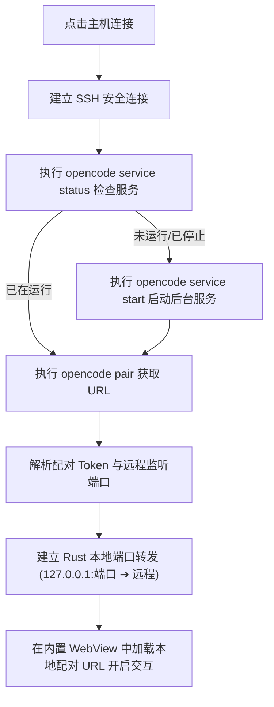

# Opencode Remote (Android)

一款适用于 Android 移动设备的 **Opencode** 远程连接管理应用，基于 **Rust + Flutter** 构建。

---

## 🌟 核心原理与设计思路

现在的 Opencode 底层改为了核心管理会话架构：
- 能够通过 `opencode service status` 检查当前后台服务状态；
- 通过 `opencode service start` 启动后台服务进程；
- 通过 `opencode pair` 生成一次性带安全 Token 的前端 Web 配对访问链接；
- 通过本地 SSH 端口转发将远程 Opencode 端口映射到 Android 设备的本地回环端口（`127.0.0.1:local_port`）。

**Opencode Remote** 的自动启动流程如下：


---

## 📱 主要功能特性

1. **主机管理与一键直连**
   - 支持保存多台服务器配置（主机地址、SSH 端口、用户名、工作目录等）。
   - 支持 **密码认证** 与 **SSH 密钥认证**（支持密码短语加密）。
   - 支持设置远程工作目录（自动 `cd` 并在此目录下运行 Opencode）。
   - 支持自定义 `opencode` 可执行文件路径（默认自动探测 `~/.opencode/bin/opencode`）。
   - 支持 SSH 连接连通性测试。

2. **内置 SSH 密钥管理器**
   - 手机端直接生成 **Ed25519**（默认推荐）、**RSA 2048/4096**、**ECDSA** 密钥对。
   - 支持导入已有 OpenSSH 私钥并验证。
   - 支持一键复制公钥到剪贴板，方便快速粘贴到服务器 `~/.ssh/authorized_keys`。

3. **透明端口转发与原生内置 WebView**
   - 基于 Rust `russh` 异步直接转发 TCP 流至 SSH 隧道通道，极佳性能与低延迟。
   - 内置 Chromium 内核 WebView，完整支持 WebSocket 实时通信与现代 Web 前端特性。
   - 顶部工具栏提供：
     - **重新获取 Token 并配对**（Token 过期时一键刷新配对）。
     - **远程服务控制**：直接在移动端重启或停止远程 Opencode 服务。
     - **在外部浏览器中打开**：支持调起 Chrome / Edge 等浏览器。
     - **实时运行日志抽屉**：随时查看底层 SSH、服务探测与端口转发的详细时间戳日志。

---

## 🛠️ 技术架构

- **UI 界面层**: [Flutter 3.24+](https://flutter.dev) (Dart 3.5+) + Material 3 现代化开发者深色主题。
- **Native 核心层**: [Rust 2021](https://www.rust-lang.org)
  - `russh`: 现代化纯 Rust 异步 SSH 2.0 客户端实现，安全可靠。
  - `ssh-key`: 现代 SSH 密钥生成、解析与加密解码库。
  - `tokio`: 异步 TCP 监听与全双工数据管道。
- **跨语言绑定**: [flutter_rust_bridge 2.x](https://github.com/fzyzcjy/flutter_rust_bridge) + [cargokit](https://github.com/irondash/cargokit)

---

## 🚀 项目结构

```
OpencodeRemote/
├── android/               # Android 原生平台配置与清单
├── lib/
│   ├── main.dart          # Flutter 应用主入口
│   ├── models/            # SshHost, SshKeyEntry 数据模型
│   ├── services/          # StorageService, OpencodeService 服务层
│   ├── theme/             # Material 3 深色主题
│   ├── views/             # HomeView, OpencodeWebViewScreen, KeysView
│   ├── widgets/           # HostFormDialog, ConnectionProgressSheet
│   └── src/rust/          # flutter_rust_bridge 自动生成的 Dart 桥接代码
├── rust/
│   ├── Cargo.toml         # Rust 依赖声明
│   └── src/
│       ├── lib.rs
│       ├── ssh.rs         # russh SSH 客户端与命令执行、端口转发
│       ├── keys.rs        # 密钥生成、解析与密码短语支持
│       ├── opencode.rs    # opencode service / pair 状态机与端口转发管线
│       └── api/simple.rs  # 对 Flutter 暴露的高级接口
└── rust_builder/          # Cargokit 构建辅助插件
```

---

## 🔨 编译构建说明

### 前置要求
- Flutter SDK 3.24+
- Rust 1.80+ (以及对应的 Android targets: `aarch64-linux-android`, `armv7-linux-androideabi`, `x86_64-linux-android`)
- Android NDK (r23+) 与 Android SDK

### 代码生成 (如修改 Rust API)
```bash
flutter_rust_bridge_codegen generate
```

### 构建 Android Debug APK
```bash
flutter build apk --debug
```

### 构建 Android Release APK
```bash
flutter build apk --release
```
生成的 APK 位于: `build/app/outputs/flutter-apk/app-release.apk`
